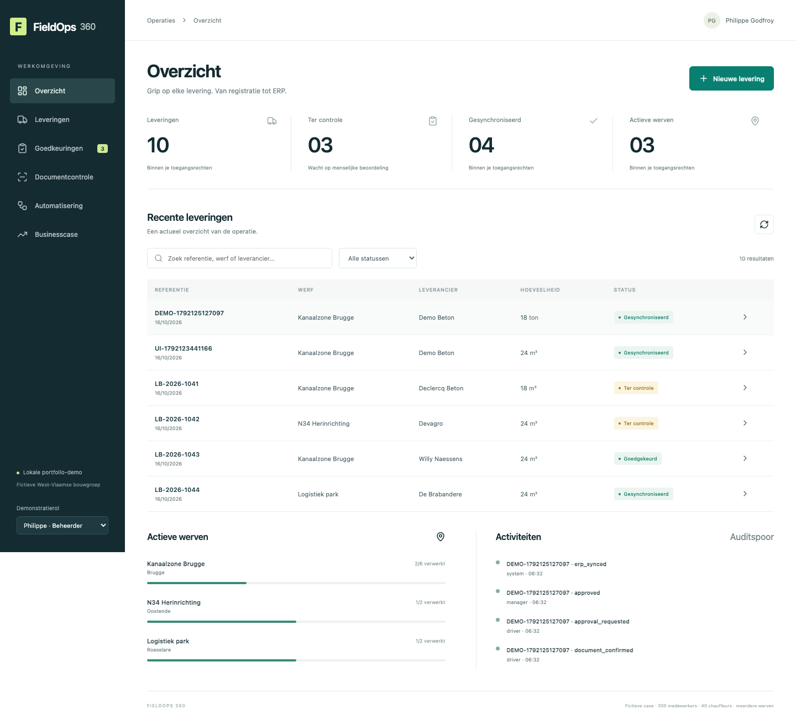

# FieldOps 360

**Digital Operations Transformation — van werfregistratie tot gecontroleerde ERP-overdracht.**

Onafhankelijke portfolio-case voor een fictieve West-Vlaamse bouw- en transportgroep met 200 medewerkers en 40 chauffeurs. Papier, Excel en e-mail maken plaats voor mobiele registratie, documentcontrole, onafhankelijke goedkeuring en betrouwbare integratie.



**Status:** de lokale webdemo is uitvoerbaar en getest. Er is een verpakte mobiele Canvas-collectieapp (`.msapp`), maar Studio-validatie en Dataverse-binding staan open. De native Dataverse/Power Automate-installatie wacht op Microsoft-omgevingsrechten. Dit is dus nog geen volledig gedeployde Power Platform-oplossing. [Exacte status en bewijs](docs/delivery-status.md).

## Zelf draaien

Node.js 24+, npm en voor lokale beeldherkenning macOS met Swift/Xcode Command Line Tools.

```sh
npm ci
npm test
npm run build
npm start
```

Open **http://127.0.0.1:3600**. Kies een demonstratierol. Chauffeur registreert → mens bevestigt OCR → werfleider keurt onafhankelijk goed → worker synchroniseert met de ERP-test-API. Data blijft tussen herstarts bewaard in `.data/`.

```sh
npx playwright install chromium
npm run test:ui
node scripts/document-smoke.mjs
npm run check:artifacts
```

Windows/Linux: de CRUD-demo werkt; voor beeld-OCR is de optionele Azure-adapter nodig. Tekstbestanden gebruiken een parser en zijn geen AI-bewijs. De lokale rolselector is bewust voor demonstratie; deze backend niet publiek hosten als productie-app.

## Bekijk de demonstratie

- [Video — echte lokale gebruikersroute, circa 2 minuten](docs/evidence/demo.webm) · [Nederlandse ondertiteling](docs/evidence/demo.nl.vtt)
- [Mobiele registratie](docs/evidence/mobile-registration.png) · [Goedgekeurd en gesynchroniseerd](docs/evidence/approved-synced.png)
- [Echte OCR-uitkomst](docs/evidence/ocr-result.json) op deze [fictieve bonfoto](samples/leveringsbon.png)
- [Demonstratiescript met toelichting](docs/demo-script.md)

## Wat je kunt demonstreren

- Mobiele formulieren met werf, bonnummer, leverancier, hoeveelheid, foto/document en afwijkingsreden.
- Zoekfunctie, statussen en rolgebonden servertoegang; chauffeur ziet eigen dossiers, werfleider eigen werf.
- Hoeveelheidsvalidatie, >5%-afwijkingsreden, unieke referenties, versiecontrole en audit.
- Echte ML-OCR via Apple Vision; voorstel corrigeren en verplicht als mens bevestigen.
- Drie werkende lokale workflows: goedkeuring, duurzame ERP-synchronisatie, foutmelding/herstel.
- ERP-idempotentie, retries, dead-letter en handmatige herstart.
- Interactieve ROI-calculator met zichtbare aannames.

## Repositorykaart

| Onderdeel | Bronnen |
|---|---|
| Business Analysis | [Probleem, stakeholders, workshop, stories en criteria](docs/business-analysis.md) |
| Processen | [AS-IS / TO-BE BPMN](docs/processes/) |
| Architectuur | [Datamodel, state machine en ontwerpbesluiten](docs/architecture.md) |
| Power Apps / flows / Dataverse | [Native bronnen en status](power-platform/README.md) |
| Canvas-appbestand | [FieldOps360.msapp — Studio-validatie vereist](power-platform/FieldOps360.msapp) |
| Security | [Rechten, privacy en productiegrenzen](docs/security.md) |
| Testen en acceptatie | [Testplan en UAT](docs/testing-uat.md) · [Testcode](tests/) |
| Gebruikers | [Handleiding](docs/user-guide.md) |
| Implementatie | [Deployment, rollback, beheer en adoptie](docs/deployment.md) |
| Businesscase | [ROI en gevoeligheid](docs/roi.md) |
| Sollicitatievoorbereiding | [16 oefeningen en eerlijke zelfevaluatie](docs/readiness.md) |
| Bewijs | [Screenshots, video, OCR en QA](docs/evidence/) |

## Microsoft-omgeving

De bestaande tenantverbinding is gecontroleerd. Een eigen FieldOps360-solution en publisher zijn aangemaakt, maar tabelcreatie wordt geweigerd met `prvCreateEntity`. De gebruiker laat deze rechten toekennen. `scripts/provision-dataverse.mjs` bevat het vervolg voor zes tabellen en relaties. Cloud flow-definities in `power-platform/flows` zijn bronontwerpen; connectorbinding, securityregels en werkelijke cloud runs zijn nog niet gevalideerd. Een complete exportbare solution-zip volgt pas na die native installatie. De lokale webapp is geen vervanging voor een echt Dataverse-/Power Apps-runtimebewijs.

## Verificatie

13 unit/API-tests en de browserroute registratie → goedkeuring → ERP zijn geslaagd. PNG-OCR herkent bonnummer, leverancier, 18 ton en eenheid correct; menselijke bevestiging blokkeert vroegtijdige indiening. Twee BPMN-bestanden zijn gecontroleerd op XML, referenties en diagramdekking. De `.msapp` is via PAC verpakt én terug uitgepakt. Geen eindgebruikers-UAT, productiebelastingtest of native Microsoft-runtimegoedkeuring is verzonnen.

Alle bedrijfsgegevens zijn fictief. ROI-bedragen zijn aannames, geen gerealiseerde besparingen of Microsoft-prijsofferte. Geen affiliatie met Nuvex Systems of genoemde leveranciers.

MIT · [Licentie](LICENSE) · [Bronvermeldingen](THIRD-PARTY-NOTICES.md)
