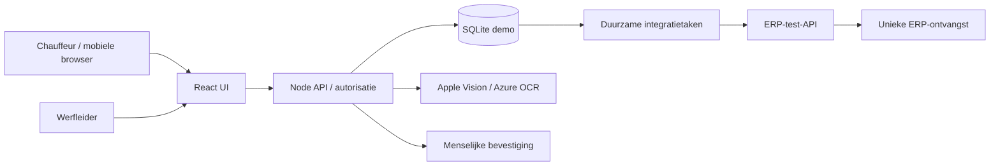
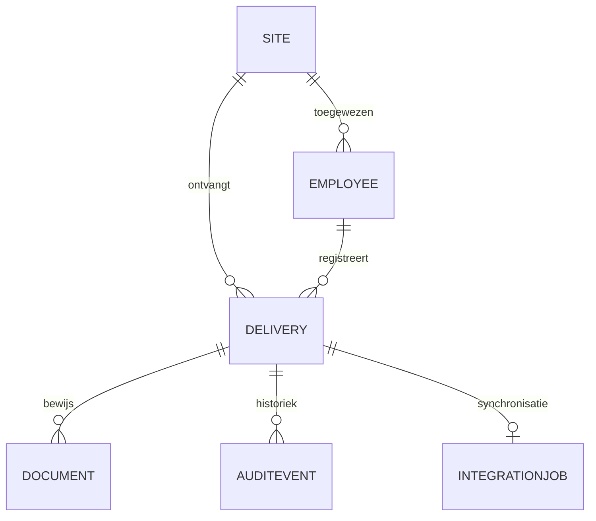

# Architectuur en ontwerpbesluiten

## Doelarchitectuur Power Platform
Canvas App → Dataverse fo_delivery/fo_document → cloud flow validatie/approval → duurzame fo_integrationjob → ERP REST API → status en audit. Foutflow monitort definitief mislukte taken en maakt beheerwerk aan. AI Builder of Azure Document Intelligence leest bonnen; mens bevestigt iedere output vóór goedkeuring. De webdemo demonstreert dezelfde bedrijfsroute maar is geen Power Apps-runtime.

## ADR01 — twee expliciete uitvoeringsvormen
Een lokale demo is reproduceerbaar zonder licenties. Native Microsoft-componenten vragen een tenant, Dataverse, connectors en rechten. Bewijs per onderdeel staat in `delivery-status.md`. Lokale workflowtests bewijzen geen werkende Power Automate-cloud flows.

## ADR02 — state machine
`draft → pending → approved → synced`; `pending → rejected → pending`. OCR-bevestiging vereist bij gekoppeld document. Synced is eindstatus in v1; correcties gaan in productie via een nieuw correctiedossier met verwijzing, nooit stil overschrijven. Version voorkomt verouderde beslissingen. Goedkeuring en integratietaak ontstaan in één transactie.

## ADR03 — delivery-ID als idempotentiesleutel
ERP slaat idempotency key uniek op en retourneert de oorspronkelijke ontvangst bij herhaling. Worker kan na een crash de ontvangst opnieuw ophalen. Dit is at-least-once delivery met idempotente verwerking; geen claim van exactly-once transport. Eén lokale worker voorkomt concurrerende taakverwerking; productie vereist atomair claimen/lease-locks.

## ADR04 — documentherkenning
Apple Vision voert op macOS echte ML-OCR uit. Regex omzetting naar velden is deterministisch. Azure-adapter gebruikt `prebuilt-read` met API-versie 2024-11-30, optioneel en niet cloudgetest zonder configuratie. Tekstuploads zijn parser-only en worden zo benoemd. OCR van foto's bewijst geen getraind AI Builder factuurmodel.

## Datamodel

Dataverse schema staat machineleesbaar in `power-platform/dataverse/schema.json`; relaties worden door `scripts/provision-dataverse.mjs` aangemaakt. fo_delivery: name, reference, supplier, quantity, expected, unit, status, note, erp_id, confirmed, site lookup, employee lookup. Business keys: leverancier + bonnummer in productie; de demo gebruikt een globaal uniek bonnummer om fouten duidelijk te maken. Voeg een Dataverse alternate key toe vóór parallelle integratie.

## Bekende technische grenzen
Geen Entra-auth in lokale demo. Geen offline writes, multiworker-locks, malware scan, productieback-upautomatisering of cloud-SLA. Bedrijfsregels in de lokale API zijn getest; native Dataverse-regels vragen een plug-in/custom API of synchronische validatie, niet uitsluitend een achteraf draaiende flow. Tot die servercontrole actief is, heeft een Canvas-only configuratie geen productie-go.
