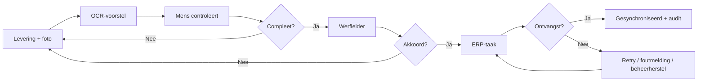

# Procesmodellen
Open `as-is.bpmn` en `to-be.bpmn` in een BPMN 2.0-editor. BPMN-DI bevat coördinaten. Modellen zijn analyseartefacten, geen uitvoerbare procesengine. De exception-loop in TO-BE bevat maximaal drie technische pogingen; na dead-letter is beheerherstel vereist. Gatewaylabels definiëren zakelijke keuzes; er staan geen engine-expressions in deze beschrijvende modellen.

AS-IS: papier → ontbrekende data najagen → e-mailgoedkeuring → dubbele overname. TO-BE: mobiele registratie → OCR → menselijke controle → onafhankelijke werfleider → betrouwbare ERP-overdracht met herstelpad.

